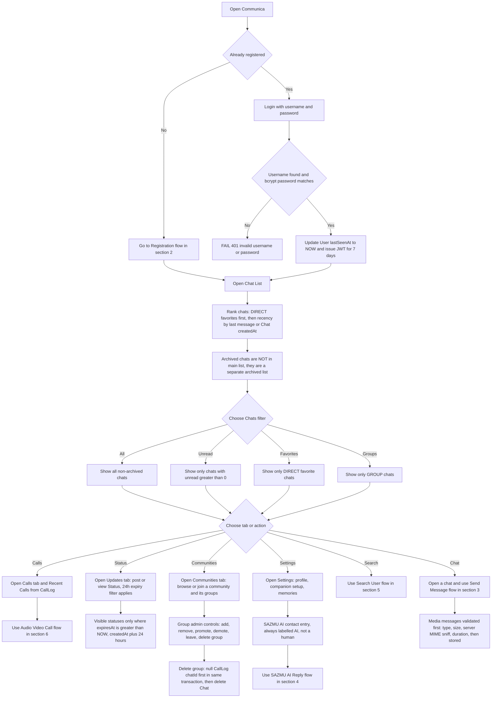
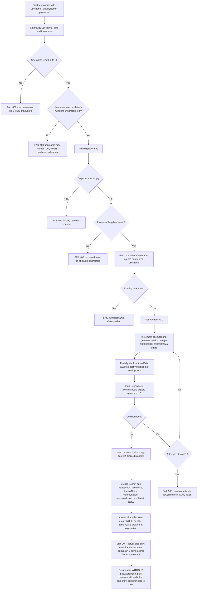
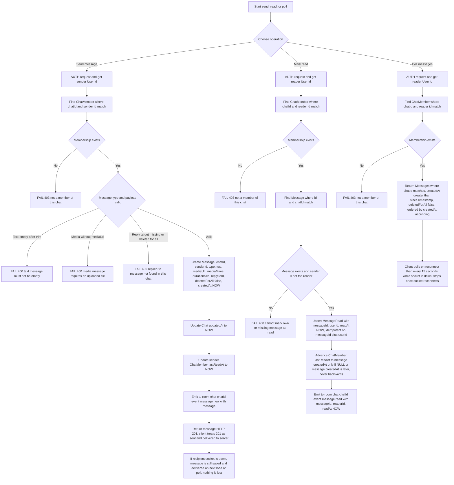
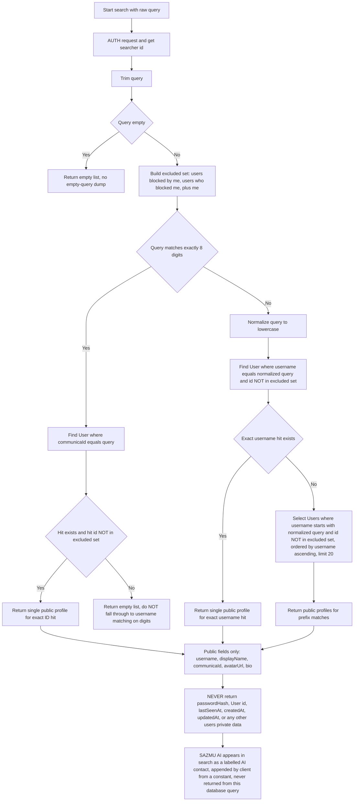
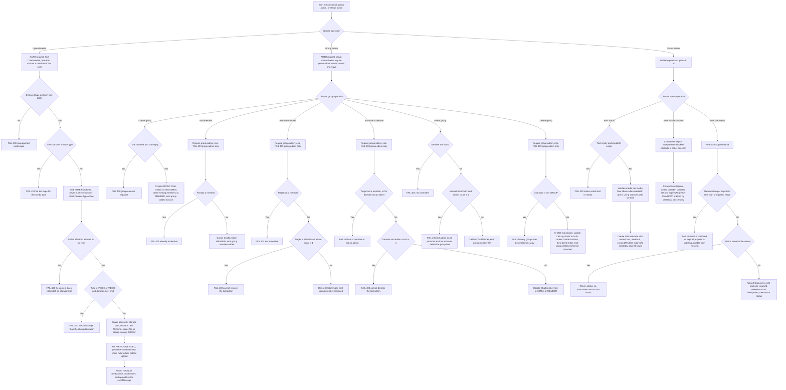

# Communica — Flowcharts (Step 4)

**Scope:** Mermaid flowcharts only — no UI, no backend code, no schema change,
no change to the plan, language, or algorithms files.

**Source of truth:** `ALGORITHMS.md` (Step 3, QA-passed, PM-approved).
Every decision, field, error code, and timestamp below comes from that file.
Nothing here invents a new gate, field, or rule.

**Fixed decisions carried over:**

- App: Communica, tagline Social Communication.
- Backend: Prisma plus Neon DB ONLY. NOT Supabase. Auth: JWT plus bcrypt.
  Realtime: WebSocket with Socket.io, plus polling fallback.
- Registration FIRST, then use. No real phone number: random 8-digit
  in-app Communica ID plus unique username.
- Calls: in-app WebRTC ONLY. Never a real phone number, never a PSTN call.
- SAZMU AI: one AI chatbot contact inside Communica, ALWAYS labelled
  AI, not a human. It is NOT a row in User. Boyfriend default call name:
  Sazzad. Girlfriend preset names: Sadia, Maria, Tithi, Borsha, Anika,
  Tajmira, Mim, Mimi, Mumu, Ayra, Jannati, Mushfika, plus a custom name.
  No girlfriend default is invented.
- Local work only: no publishing, no credentials, no live database push.

**Mermaid conventions used below:**

- `flowchart TD` in every diagram.
- Diamond nodes are decisions. Rectangular nodes are actions or results.
- FAIL nodes stop the flow and return the error shown, exactly as in
  `ALGORITHMS.md`. Later steps are not run after a FAIL.
- NOW means current server time in UTC, server as source of truth.
- AUTH means verify the JWT; missing, expired, or invalid token gives
  FAIL 401 unauthenticated.

---

## 1. Overall app flow

Register or Login first, then Chat List, then Chat, Calls, Status,
Communities, and Settings. Chat list ranking, group admin controls,
Status 24h expiry, and media validation appear here as branches; their
full step-by-step logic lives in the matching sections below and in
`ALGORITHMS.md` sections 3, 6, 8, and 9.

Algorithm trace: plan tabs Chats, Updates, Communities, Calls; chat list
filters All, Unread, Favorites, Groups plus Archived; ranking favorites
first for DIRECT only then recency; Status expiry `createdAt + 24 hours`
with `expiresAt > NOW` filter on every read; group delete nulls
`CallLog.chatId` before deleting `Chat`, in one transaction.

---

## 2. Registration

Covers `ALGORITHMS.md` section 1, registration only. Login primitives are
shown in the overall flow above; login itself reuses the same
normalization, bcrypt verify, `lastSeenAt` update, and JWT issuance.

Algorithm trace: normalization, length, character set, display name,
password minimum 8, username uniqueness 409, collision retry loop with
10-attempt cap and 500, first digit 1 to 9, bcrypt cost 12, one-transaction
create, `lastSeenAt NOW`, JWT 7 days, no `passwordHash` in the return.

---

## 3. Send Message

Covers `ALGORITHMS.md` section 4 in full: send, read receipt, and
polling fallback. Media validation from section 6 is the step that
supplies `mediaUrl`, `mediaMime`, and `durationSec` to a media message.

Algorithm trace: AUTH, membership 403, TEXT empty 400, media without
upload 400, reply target check 400, Message create fields, `Chat.updatedAt`,
sender `lastReadAt`, room emit `message:new`, HTTP 201 delivered-to-server
meaning, offline save-then-poll, `markRead` own-or-missing 400, MessageRead
upsert, watermark never backwards, emit `message:read`, poll membership
403, `createdAt > sinceTimestamp`, `deletedForAll false`, ascending order,
15-second polling interval.

---

## 4. SAZMU AI Reply

Covers `ALGORITHMS.md` section 5 in full. Safety order is fixed and
cannot be skipped or reordered: distress first, then sexual content,
then boundary. SAZMU AI is labelled AI in every step, never a real human.

```mermaid
flowchart TD
    AStart["Start SAZMU AI reply with user text"] --> AAuth["AUTH request and get user id"]
    AAuth --> ASet["Find CompanionSetting where userId matches"]
    ASet --> ASetQ{"CompanionSetting exists"}
    ASetQ -->|No| ASetFail["FAIL 400 companion not set up yet"]
    ASetQ -->|Yes| ASetupNote["Setup first: role Boyfriend or Girlfriend, callName, optional petName"]
    ASetupNote --> ABoyNote["Boyfriend default callName is Sazzad"]
    ABoyNote --> AGirlNote["Girlfriend callName is a preset or custom name, no girlfriend default is invented"]
    AGirlNote --> ADistressQ{"User text signals distress, self-harm, or crisis"}
    ADistressQ -->|Yes| ADistress["Return caring non-medical reply: acknowledge feelings, encourage a trusted real person or local professional helpline, never diagnose, never give medical advice, never claim to be human"]
    ADistressQ -->|No| ASexualQ{"User text is sexual or asks for sexual or romantic-physical content"}
    ASexualQ -->|Yes| ASexual["Return warm non-sexual redirect to feelings, daily life, encouragement, poetry, no erotic content ever"]
    ASexualQ -->|No| ABoundQ{"User text sets a boundary, for example stop, do not say that, leave me alone"}
    ABoundQ -->|Yes| ABound["Return boundary respect reply: acknowledge boundary, stop that topic at once, do not argue, do not repeat unwanted content, offer a neutral topic"]
    ABoundQ -->|No| ALang["Detect incoming language: Bengali script, Banglish Latin script plus Bengali words, or English"]
    ALang --> ALangOut["Reply language follows CompanionSetting language when set, detection decides which intent vocabulary to match first"]
    ALangOut --> AIntent["Match intent by keywords in detected language: greeting, how-are-you, evening plans, what-to-eat, dreams, missing-you, comfort, celebration, planning, teasing, romantic poetry, general question, unknown"]
    AIntent --> AMem["Select this user only UserMemory rows for keys relevant to intent, plus displayName from User"]
    AMem --> AMemNote["NEVER other users memories, private chats, or scraped data"]
    AMemNote --> ALLMQ{"LLM backend is configured"}
    ALLMQ -->|Yes| ALLM["Generate via backend proxy only: key server-side in secure vault, never in frontend, frontend never calls provider directly"]
    ALLM --> ALLMSafe["Proxy re-applies safety rules from distress, sexual, boundary steps to generated text"]
    ALLMQ -->|No| ATemplate["Use template reply for intent, settings, memories, reply language"]
    ATemplate --> ATemplateNote["Template replies MUST be labelled as templates, not as generative AI output, until LLM backend exists"]
    ALLMSafe --> AUnknownQ{"Intent is general question and reply has no grounded answer"}
    ATemplateNote --> AUnknownQ
    AUnknownQ -->|Yes| AUnknown["Return honest unknown reply in reply language, for example I do not know that, I am SAZMU AI, and I would rather say so than guess, never invent a fact"]
    AUnknownQ -->|No| AIntroQ{"First message of conversation OR user asks who are you or are you real"}
    AUnknown --> AIntroQ
    AIntroQ -->|Yes| AIntro["Prefix AI introduction: I am SAZMU AI, an AI chatbot, not a human, plus role and callName, and petName when set"]
    AIntroQ -->|No| AReturn["Return reply, always with SAZMU AI labelled AI, not a human"]
    AIntro --> AReturn
    AReturn --> AMaybe["Optional memory write: only if user plainly stated a storable fact about themself"]
    AMaybe --> AMaybeNote["Upsert UserMemory with userId, key, value, updatedAt NOW, never infer sensitive facts, never store another persons data, user can delete memories at any time"]
```

Algorithm trace: setup FAIL 400, Boyfriend default Sazzad, girlfriend
presets plus custom with no invented default, safety order
distress, sexual, boundary, language detection Bengali, Banglish, English,
settings language wins for output, intent list, own `UserMemory` only,
LLM-later backend-proxy branch with server-side key and re-applied safety,
template fallback labelled as templates, honest-unknown for ungrounded
general questions, AI introduction on first message or identity question,
`maybeRemember` upsert rule.

---

## 5. Search User

Covers `ALGORITHMS.md` section 2 in full. Communica ID search is
EXACT-ONLY. No partial ID search exists in any branch.

Algorithm trace: AUTH, empty query returns empty, blocked exclusion in
both directions plus self, exact 8-digit match tried FIRST, 8-digit
no-fallthrough rule, username exact before prefix, prefix limit 20
ascending, public fields only, excluded private fields, SAZMU AI as
client constant not a `User` row.

---

## 6. Audio and Video Call

Covers `ALGORITHMS.md` section 7 in full, including timestamps,
caller-cancel, and the TURN fallback note. Media is peer-to-peer WebRTC
once signalling completes; the server relays signalling only and never
sees media.

```mermaid
flowchart TD
    CallStart["Start call with calleeId, chatId, type AUDIO or VIDEO"] --> CallAuth["AUTH request and get caller id"]
    CallAuth --> CallGate["Find Contact where ownerId equals calleeId and contactUserId equals caller id"]
    CallGate --> CallGateQ{"Gate row exists and accepted is true and isBlocked is false"}
    CallGateQ -->|No| CallGateFail["FAIL 403 calls are only allowed to accepted contacts"]
    CallGateQ -->|Yes| CallBusyQ{"Callee already has an active call in signalling server in-memory active-call set, NOT in database"}
    CallBusyQ -->|Yes| CallBusyLog["Create CallLog: callerId, calleeId, chatId, type, status CANCELLED, startedAt NOW"]
    CallBusyLog --> CallBusyReturn["Return status busy and callLogId, callee is not interrupted"]
    CallBusyQ -->|No| CallRegister["Register active call: callId, callerId, calleeId, chatId, type, ringingSince NOW, startedAt NULL, callLogId NULL"]
    CallRegister --> CallIncoming["Emit to room user calleeId event call incoming with callId, callerId, chatId, type"]
    CallIncoming --> CallWait["Caller waits for accept, decline, cancel, or timeout, return status ringing"]
    CallWait --> CallOutcome{"What happens next"}
    CallOutcome -->|Callee accepts| CallAcceptAuth["AUTH callee, check active call exists and callee id matches, else FAIL 403 only the callee can accept"]
    CallOutcome -->|Callee declines| CallDeclineAuth["AUTH callee, check active call exists and callee id matches, else FAIL 403 only the callee can decline"]
    CallOutcome -->|Caller cancels before answer| CallCancelAuth["AUTH caller, check active call exists and caller id matches, else FAIL 403 only the caller can cancel an unanswered call"]
    CallOutcome -->|No answer in 30 seconds| CallTimeout["Timeout path: if active call still exists, create CallLog status MISSED with startedAt equal to ringingSince"]
    CallOutcome -->|Signalling| CallSignalAuth["AUTH user, check active call exists and user is caller or callee, else FAIL 403 not a party to this call"]
    CallAcceptAuth --> CallAcceptLog["Create CallLog: status ACCEPTED, startedAt NOW, set active call callLogId and startedAt to NOW"]
    CallAcceptLog --> CallAcceptEmit["Emit to room user callerId event call accepted with callId"]
    CallAcceptEmit --> CallSignalFlow["WebRTC offer, answer, ICE exchange proceeds through relay below"]
    CallDeclineAuth --> CallDeclineLog["Create CallLog: status DECLINED, startedAt NOW, remove active call"]
    CallDeclineLog --> CallDeclineEmit["Emit to room user callerId event call declined with callId"]
    CallCancelAuth --> CallCancelQ{"Active call callLogId is NOT NULL, meaning already accepted"}
    CallCancelQ -->|Yes| CallCancelFail["FAIL 400 call already accepted, use call ended, not cancel"]
    CallCancelQ -->|No| CallCancelLog["Create CallLog: status CANCELLED, startedAt equal to ringingSince, remove active call"]
    CallCancelLog --> CallCancelEmit["Emit to both rooms user calleeId and user callerId event call cancelled with callId"]
    CallTimeout --> CallTimeoutEmit["Remove active call, emit to both caller and callee event call missed with callId"]
    CallSignalAuth --> CallSignalRelay["Relay signal only to other party room user otherId event call signal with callId, kind offer or answer or ice, and payload, server never sees media"]
    CallSignalRelay --> CallSignalFlow
    CallSignalFlow --> CallEndQ{"Call ends after acceptance"}
    CallEndQ -->|Yes| CallEndAuth["AUTH user, check active call exists and user is caller or callee, else FAIL 403 not a party to this call"]
    CallEndAuth --> CallEndGuardQ{"Active call callLogId NULL or startedAt NULL, meaning not accepted yet"}
    CallEndGuardQ -->|Yes| CallEndFail["FAIL 400 call not accepted yet, caller uses cancel, callee uses decline"]
    CallEndGuardQ -->|No| CallEndCalc["Set endedAt NOW, durationSec equals seconds between startedAt and endedAt"]
    CallEndCalc --> CallEndUpdate["Update CallLog to status ENDED, endedAt, durationSec, remove active call"]
    CallEndUpdate --> CallEndEmit["Emit to both parties event call ended with callId and durationSec"]
    CallEndEmit --> TurnNote["TURN fallback: if direct peer-to-peer WebRTC fails on strict NAT or firewall, relay media through TURN server"]
    TurnNote --> TurnNote2["TURN is a media relay only, it does not change gate, signalling, or CallLog rules, and it is never a PSTN gateway"]
    CallTimeoutEmit --> CallLogNote["CallLog is written for EVERY attempt, including missed and declined, so Recent Calls list is complete"]
    CallDeclineEmit --> CallLogNote
    CallCancelEmit --> CallLogNote
    CallBusyReturn --> CallLogNote
```

Algorithm trace: accepted-contact gate before any signalling, busy as
CANCELLED with `startedAt NOW`, register with `ringingSince NOW` and
`startedAt NULL`, incoming emit, signal relay for offer, answer, ICE
with party check, accept creates ACCEPTED log and sets `startedAt NOW`,
decline creates DECLINED log, caller-cancel creates CANCELLED log with
`startedAt = ringingSince` and is rejected once accepted, 30-second
timeout creates MISSED log with `startedAt = ringingSince`, end guard
rejects unaccepted calls, end computes duration from `startedAt` to
`endedAt` and updates to ENDED, TURN fallback as media relay only.

---

## 7. Supporting flows: Media upload, Group admin, Status 24h

These three algorithms feed the flows above. They are diagrammed here so
no step from `ALGORITHMS.md` sections 6, 8, or 9 is left as a branch-only
note. They add no new rule beyond those sections.

Algorithm trace: media limits PHOTO 10 MB, VOICE 16 MB and 300 seconds,
VIDEO 100 MB and 600 seconds, FILE 25 MB, with MIME lists from section 6;
validation order type, size, server MIME sniff, duration; server-generated
path, thumbnail best effort. Group: creator first ADMIN, add 409,
remove and demote last-admin 400, leave last-admin 400, delete any ADMIN,
delete only GROUP, null `CallLog.chatId` in same transaction before
deleting `Chat`. Status: post requires text or media, `expiresAt`
`createdAt + 24 hours`, visible set own plus accepted not-blocked either
direction, `expiresAt > NOW` filter on every read, expired view 404,
`StatusView` upsert only for other users statuses.

---

## 8. Overall verification checklist

- [x] Overall app flow: Register and Login first, then Chat List, Chat,
  Calls, Status, Communities, Settings.
- [x] Registration: username validation, random ID plus collision retry,
  bcrypt, JWT.
- [x] Send Message: auth, membership check, save, WebSocket emit,
  delivery ack, read receipt, polling fallback.
- [x] SAZMU AI Reply: safety-first order distress, sexual, boundary,
  then language, intent, memory, LLM-later branch, template fallback,
  honest-unknown, AI label.
- [x] Search User: exact 8-digit ID first, then username exact and
  prefix, public fields only, blocked excluded, no partial ID search.
- [x] Audio and Video Call: accepted-contact gate, offer, answer, ICE,
  accept, decline, busy, missed, caller-cancel, CallLog write, TURN
  fallback note.
- [x] Supporting flows: media validation order, group admin controls
  and group delete nulling `CallLog.chatId` before deleting `Chat`,
  Status 24h expiry.
- [x] No Supabase implementation anywhere. No PSTN. SAZMU AI labelled AI
  in every SAZMU AI step.

**Steps not silently dropped:** none. Every algorithm step from sections
1 to 9 has a matching node above. The 7 diagrams are: overall, registration,
send message, SAZMU AI reply, search user, audio and video call, plus
supporting media, group, and Status flows.
